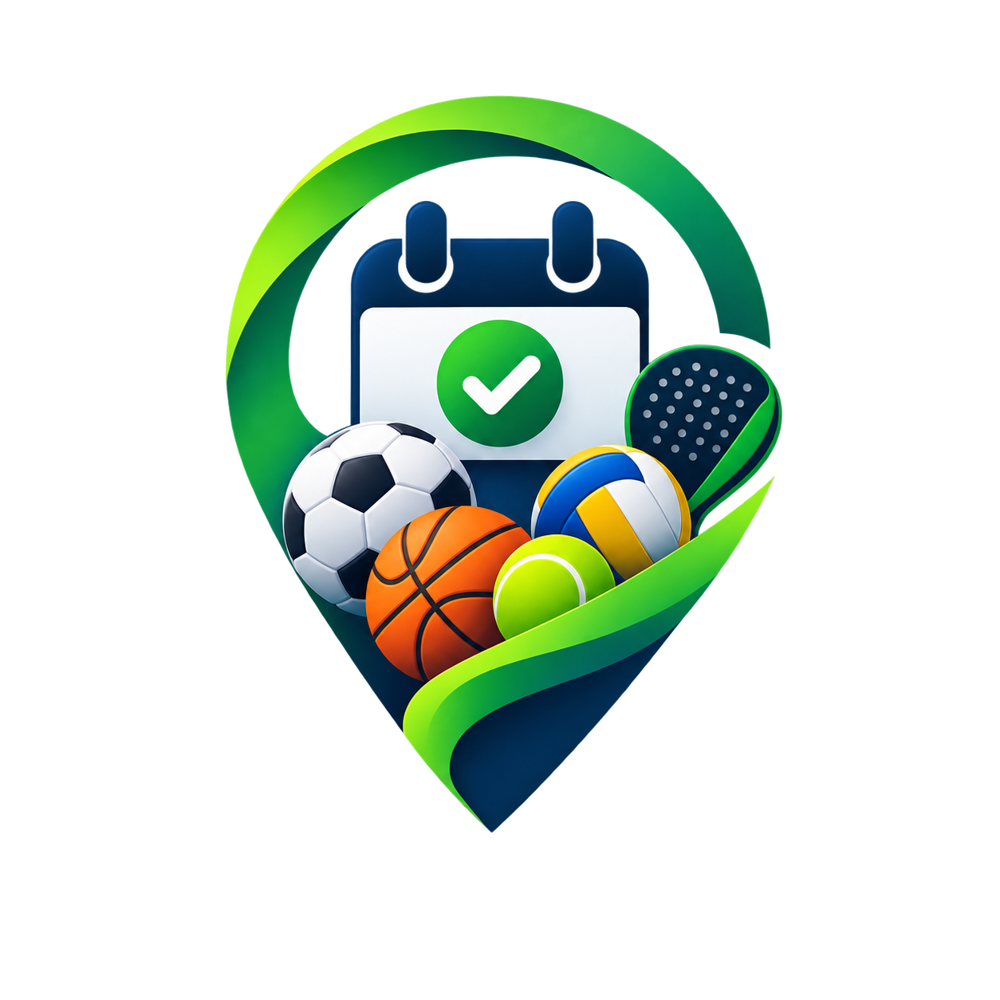

    

<h1 align="center">ReservaTuCancha</h1>

Reserva canchas deportivas de forma rápida, sencilla y sin complicaciones.

    
    
    
    
    
    

---

ReservaTuCancha es una plataforma web y una app móvil (Android/iOS, en el repo ReservaTuCancha_Movil) que permite reservar canchas deportivas de forma rápida, sencilla y sin complicaciones.

Está pensada para modernizar la forma en que los clubes gestionan sus reservas y mejorar la experiencia de los usuarios que buscan jugar.

---

🌟 ¿Qué es ReservaTuCancha?

Es una solución digital que conecta a personas que quieren jugar con clubes que ofrecen canchas deportivas.

Permite reservar espacios como:

- Fútbol ⚽
- Pádel 🎾
- Voley playa 🏐

Todo en pocos pasos y sin necesidad de crear una cuenta para jugar.

---

🎯 Problema que resuelve

Muchos clubes gestionan sus reservas de forma manual (WhatsApp, llamadas o agendas), lo que genera:

- Confusión de horarios
- Doble reserva de canchas
- Pérdida de clientes
- Falta de control del negocio

ReservaTuCancha organiza todo en una sola plataforma, automatizando el proceso.

---

🚀 ¿Cómo funciona?

El proceso es muy simple:

1. El usuario entra a la web o a la app.
2. Busca una cancha según sus preferencias (o las que tiene cerca).
3. Selecciona fecha y hora, y si quiere, la repite cada semana (turno fijo).
4. Ingresa sus datos básicos.
5. Paga en línea con ePayco (tarjeta, PSE, Nequi, DaviPlata).
6. Recibe la confirmación por correo y, en la app, como notificación.

Si el horario que quiere está ocupado, puede anotarse en la lista de espera y le avisamos si se libera. Puede mover su reserva hasta 24 horas antes y, después de jugar, dejar una reseña.

---

👥 Tipos de usuarios

Clientes:

- No necesitan registrarse.
- Pueden buscar, reservar, pagar y mover su reserva de horario fácilmente.

Propietarios:

- Gestionan sus canchas, horarios y bloqueos.
- Visualizan reservas en tiempo real y reciben un push por cada reserva pagada.
- Anotan las reservas que les llegan por teléfono o al mostrador.
- Ven la ocupación de sus canchas por día y hora.
- Dan acceso al panel a su equipo (sin pagos ni configuración de cobro).

Administradores:

- Supervisan toda la plataforma.
- Gestionan usuarios.
- Acceden a estadísticas globales.

---

💡 Beneficios principales

- Reservas rápidas y sin fricción.
- Reducción de errores como dobles reservas.
- Pagos en línea seguros.
- Comunicación automática con los usuarios.
- Panel de control para gestionar el negocio.
- Información clara para tomar decisiones.

---

📩 Comunicación automática

El sistema mantiene informados a los usuarios por correo, notificaciones push de la app y WhatsApp:

- Confirmación de reserva y de pago
- Recordatorio 24 horas antes del turno (correo, push y WhatsApp)
- Aviso de turno liberado para quien está en lista de espera
- Invitación a dejar reseñas

---

📊 Inteligencia del negocio

Los propietarios pueden:

- Ver estadísticas de reservas
- Analizar el rendimiento de sus canchas
- Tomar decisiones basadas en datos

---

🌍 Visión del proyecto

ReservaTuCancha busca digitalizar la gestión de espacios deportivos en Colombia y Latinoamérica, haciendo que el proceso sea:

- Más rápido
- Más organizado
- Más profesional

---

🧩 En resumen

ReservaTuCancha es una plataforma que conecta a jugadores y clubes en un solo lugar, permitiendo:

- Reservar fácilmente
- Gestionar negocios deportivos
- Mejorar la experiencia de todos los usuarios

---

🛠️ Para desarrolladores

- `Backend/` — API en NestJS + MongoDB (`npm run start:dev`, pruebas con `npm test`).
- `Frontend/` — Next.js 14 (`npm run dev`).
- Cada push a `main` corre build y pruebas en GitHub Actions y despliega al VPS con PM2.

Variables de entorno opcionales del backend (`Backend/.env`). Sin ellas, cada función queda apagada y el resto sigue igual:

| Variable | Para qué |
| --- | --- |
| `FIREBASE_SERVICE_ACCOUNT` | Notificaciones push (JSON de la cuenta de servicio de Firebase, plano o en base64). |
| `WHATSAPP_TOKEN`, `WHATSAPP_PHONE_NUMBER_ID` | Recordatorios por WhatsApp Cloud API. |
| `WHATSAPP_TEMPLATE_RECORDATORIO`, `WHATSAPP_TEMPLATE_IDIOMA` | Nombre e idioma de la plantilla aprobada (por defecto `recordatorio_reserva` y `es`). Variables del cuerpo: nombre, cancha, fecha, horario, código. |
| `SENTRY_DSN`, `SENTRY_ENVIRONMENT`, `SENTRY_TRACES_SAMPLE_RATE` | Monitoreo de errores del backend. |

En la web (`Frontend/.env.production`): `NEXT_PUBLIC_SENTRY_DSN` para los errores del navegador, `NEXT_PUBLIC_SITE_URL` para el sitemap y las URLs canónicas, y `SENTRY_AUTH_TOKEN`, `SENTRY_ORG` y `SENTRY_PROJECT` si se quieren subir los source maps.

---

Hecho con ❤️ en Colombia 🇨🇴
